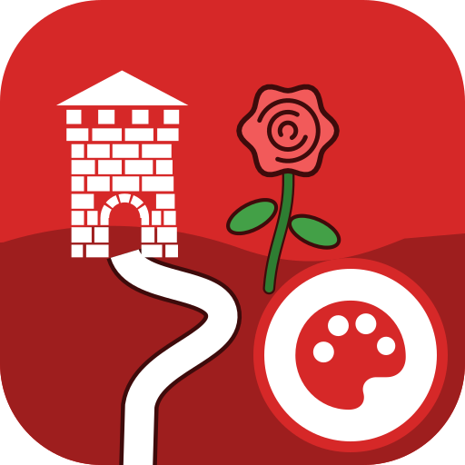

<h1 align="center">Rosenweg Paint</h1>

Zeichen-App für die Smartphones der Siedlung Rosenweg – Zeichnungen liegen in der eigenen Rosenweg-Nextcloud.

<a href="https://www.rosenweg4303.ch/apps">Herunterladen</a> · <a href="docs/anleitung.md">Anleitung</a> · <a href="docs/entwickeln.md">Für Entwickler</a>

## Was die App kann

- Zeichnen mit Pinsel, Farben und Radierer.
- Zeichnungen werden in `Persönlich/Paint` gespeichert und lassen sich von dort wieder öffnen.
- Ohne Netz zeichnen – hochgeladen wird, sobald Netz da ist.
- Einstellungen gehören der Person und sind auf jedem Telefon wieder da.

## Plattformen

Android.

## Entwickeln

Android-App (Kotlin) auf Basis von Fossify Paint, gebaut gegen
[commons-rosenweg](https://github.com/Rosenweg/commons-rosenweg): `./gradlew assembleFossRelease` –
Bau, Signatur, Logo und Veröffentlichung stehen in [docs/entwickeln.md](docs/entwickeln.md).

## Herkunft und Lizenz

Basiert auf [Fossify Paint](https://github.com/FossifyOrg/Paint) – herzlichen Dank an das Fossify-Team und alle Mitwirkenden.
GPL-3.0, siehe [LICENSE](LICENSE).
